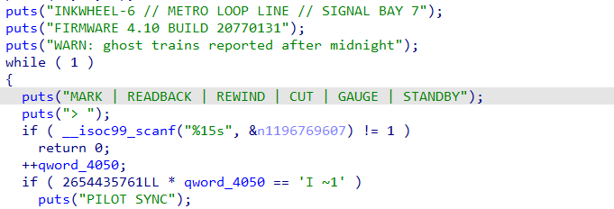
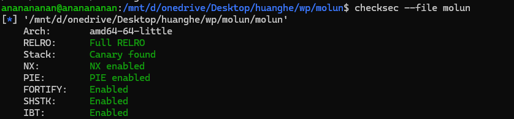
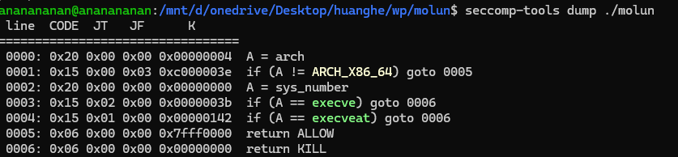

# 静态分析
### 初始化
和postbox非常相似

依旧英文读不懂
标记 | 回读 | 倒带 | 剪切 | 表计 | 待机
好像翻译过来也看不太懂
## mark
```
{                                           // mark
      puts("cells:");
      if ( __isoc99_scanf("%u", &n) == 1 )
      {
        do
          in = getc(stdin);
        while ( in != -1 && in != '\n' );
        length = *&n.len;
        if ( *&n.len > 0x20u )
        {
          *&n.len = 0x20;
          length = 32;
        }
        if ( 288 - gobel_p < length )
        {
          puts("TAPE END");
        }
        else
        {
          puts("ink:");
          v5 = *&n.len;
          if ( *&n.len )
          {
            start = &v17[gobel_p];
            end = &v17[gobel_p + 1 + *&n.len - 1];
            do
            {
              LOBYTE(buf) = 0;
              if ( read(0, &buf, 1u) != 1 )
              {
                puts("READ FAULT");
                v5 = *&n.len;
                goto LABEL_26;
              }
              if ( buf == '\n' )
                break;
              *start++ = buf;
            }
            while ( start != end );
            v5 = *&n.len;
          }
LABEL_26:
          gobel_p += v5;
          puts("MARKED");
        }
      }
    }
```
逆向完大致如下
## READBACK
```
{                                         // READBACK
        puts("from:");
        if ( __isoc99_scanf("%u", &buf) == 1 )
        {
          do
            n10_1 = getc(stdin);
          while ( n10_1 != 10 && n10_1 != -1 );
          puts("cells:");
          if ( __isoc99_scanf("%u", &n) == 1 )
          {
            do
              n10_2 = getc(stdin);
            while ( n10_2 != -1 && n10_2 != 10 );
            if ( *&n.len > 0x20u )
              *&n.len = 32;
            if ( buf <= 0x120 && *&n.len + buf <= 0x120 )
            {
              __printf_chk(1, "RB %u\n", *&n.len);
              write(1, &v17[buf], *&n.len);
              write(1, "\n", 1u);
            }
            else
            {
              puts("NO TAPE");
            }
          }
        }
      }
```
存在任意读取buf <= 0x120 && \*&n.len + buf <= 0x120对buf的检验不够严格
## REWIND
```
{
          puts("cells:");
          if ( __isoc99_scanf("%u", &n) == 1 )
          {
            do
              n10 = getc(stdin);
            while ( n10 != -1 && n10 != '\n' );
            if ( *&n.len > gobel_p )
              *&n.len = gobel_p;
            gobel_p -= *&n.len;
            __printf_chk(1, "REWOUND %u\n", *&n.len);
          }
```
指针回退，往后回退n格，如果n大于全局指针就直接清零
## cut
```
else if ( n1196769607 == 'TUC' )
        {
          gobel_p = 0;
          puts("CUT OK");
        }
```
这很简单先生
## GAUGE | STANDBY
```
else if ( n1196769607 == 'GUAG' && WORD2(n1196769607) == 'E' )
        {
          __printf_chk(1, "HEAD %u FREE %u\n", gobel_p, 288 - gobel_p);
        }
        else
        {
          if ( n1196769607 == 'YBDNATS' )
          {
            puts("STANDBY");
            return 0;
          }
          puts("?");
        }
      }
      
```
也就是
```
GAUGE   -> printf("HEAD %u FREE %u\n", head, 288 - head);
```
STANDBY退出
# 文件分析

齐全
看下glibc版本

依旧影子栈是摆设

# 漏洞分析
v17有0x120而栈只有0x88存在溢出
# 修补
对四处的0x120改成0x48
# 利用
先用任意读读出金丝雀，再用任意写rop读出flag
